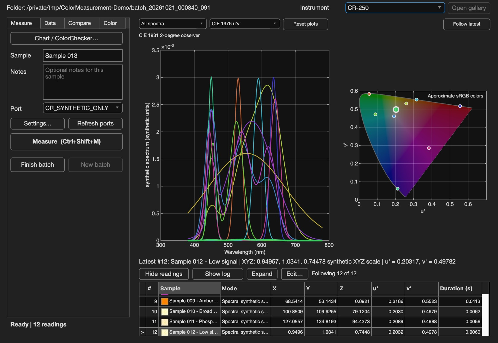
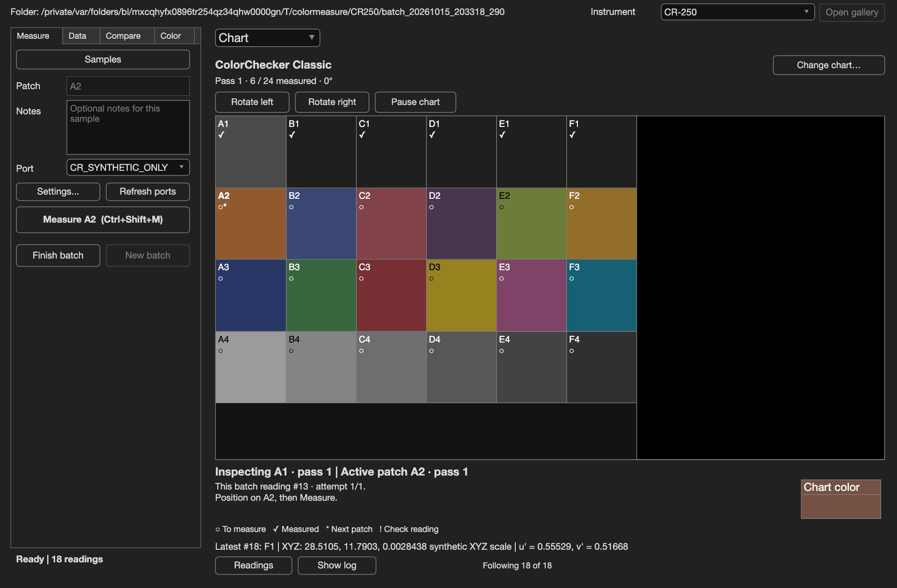

# Color Measurement for MATLAB

A MATLAB measurement app with instrument drivers for
[Photo Research PR-655](docs/drivers/pr/README.md),
[Colorimetry Research CR-100, CR-250 and CR-300](docs/drivers/cr/README.md), and
[Konica Minolta CS-2000 and CS-2000A](docs/drivers/cs2000/README.md).
Collect readings, compare samples and save results for your own MATLAB scripts.

**[Download the UI + drivers ZIP](https://github.com/ferazambuja/colormeasure-matlab/releases/download/v0.1.0-beta.2/ColorMeasurement-MATLAB-Beta.zip)**

Runs inside **MATLAB R2026b or newer**, with the JVM enabled.

**Public beta:** try the demo or help test a connected instrument. Physical
instrument testing is still pending; this release does not establish measurement
accuracy or calibration.

## Features

- **Measure and save together.** Full MAT snapshots after each complete reading;
  **Finish batch** exports CSV. Names, notes, timing and capture metadata stay
  with the data.
- **See your results.** Linked spectra, chromaticity, a reading table and detailed
  numerical results in one window.
- **Compare samples.** Inspect spectral differences, XYZ, Lab and CIEDE2000 with
  a chosen reference white.
- **Explore color.** Chromatic adaptation and measured-reference reflectance/relighting
  are separate derived views; acquired data stays unchanged. Export analysis separately.
- **Read guided charts.** **Chart / ColorChecker…** opens Classic, Digital SG or
  custom grids that track patch positions,
  missing readings, repeated attempts and selected results. Continue saved charts
  in a linked new batch while retaining their source history.
- **Control capture settings.** Adjust model-specific settings and inspect the
  instrument's readback.
- **Edit and recover.** Correct sample names and notes, restore hidden windows
  and retry saving without repeating a reading.
- **Use your own scripts.** Use the drivers directly or load saved MATLAB structs.
- **Try it without equipment.** Explore a gallery of generated readings or
  practice collecting samples and charts.



*Demo with generated readings.*



*Chart mode with generated readings.*

## Start here

1. Download and extract the ZIP.
2. Open MATLAB and set its **Current Folder** to the extracted **ColorMeasurement-MATLAB** folder
   (or to your clone of this repository).

### Explore the UI without hardware

Open [demoDirectInstruments.m](demoDirectInstruments.m) and click **Run**, or enter:

```matlab
demoDirectInstruments
```

Choose an instrument model, then select **Measure** to add generated readings.
Try **Data**, **Compare**, **Color**, **Settings...** and **Chart / ColorChecker…**.
No instrument is needed.

### Test an instrument and share feedback

Open [testLabInstrument.m](testLabInstrument.m) and click **Run**, or enter:

```matlab
testLabInstrument
```

This captures a first device test: three readings and a brief
look at the results window.

1. Choose your instrument, then follow the prompts to prepare it and select its port.
2. Keep the target steady and confirm each of the three readings.
3. When the window opens, check the readings and plots, then close it.
   Answer the final prompt and add a note if helpful.
4. **Open an [instrument test issue](https://github.com/ferazambuja/colormeasure-matlab/issues/new?template=instrument-test.yml)**
   and share the result and any error, even if the check fails. You can attach
   the ZIP from **Desktop → ColorMeasurement-Reports**. MATLAB prints its location.

Issue attachments are public. The ZIP holds your readings, the instrument's
serial number and settings, and file paths that can show your computer user
name. To keep those private, leave the ZIP out and paste the result and any
error message instead.

After a passed check, the app reopens. Select **New batch** and choose a save
folder for your own measurements, or stop there. See the
[feedback guide](docs/feedback.md) for other feedback.

## Use the app

Open [openColorMeasure.m](openColorMeasure.m) and click **Run**, or enter:

```matlab
openColorMeasure
```

Choose your instrument and save folder. Opening the window never measures
automatically. Select **Measure** for each reading and **Finish batch** when done.
Closing the window hides the retained batch; **New batch** creates a separate
collection.

## Your data belongs in your MATLAB workflow

- **`measurements.mat` is the full record:** ordinary `measurements` structs and
  `batchInfo`, including settings, metadata and chart history when present.
- **`measurements.csv` is a supporting table:** written at Finish; spectral
  instruments use one row per wavelength per reading.
- **`chart-selected.csv` summarizes chart selections:** it does not replace the
  complete attempt history in MAT.
- A save failure retains completed readings for recovery; use **Retry save**
  or **Another folder** before closing MATLAB.

Read the **[saved-data guide and MATLAB import examples](docs/saved-data.md)**.
The runnable [loadSavedBatch.m](examples/loadSavedBatch.m) opens a batch and builds
an XYZ summary without launching the app or connecting hardware.

```matlab
saved = load('measurements.mat', 'measurements', 'batchInfo');
readings = saved.measurements;
if ~isempty(readings)
    XYZ = vertcat(readings.XYZ);  % inspect each reading's units and XYZ source
end
```

## Use the drivers in your scripts

| Model key | Instrument and guide | Returned measurements |
| --- | --- | --- |
| `PR655` | [PR-655; tentative PR-670](docs/drivers/pr/README.md) | Spectrum and host-calculated XYZ |
| `CR100` | [Colorimetry Research CR-100](docs/drivers/cr/README.md) | Instrument XYZ; no spectrum |
| `CR250`, `CR300` | [Colorimetry Research CR-250 / CR-300](docs/drivers/cr/README.md) | Spectrum, host XYZ and instrument XYZ |
| `CS2000` | [Konica Minolta CS-2000 / CS-2000A](docs/drivers/cs2000/README.md) | Spectrum and instrument XYZ |

Driver guides include setup and examples for your own scripts.
Use the documented `colormeasure.drivers` class names and data fields.
These are not complete drop-in replacements for older drivers.

## Use MATLAB commands

The [session guide](docs/session/README.md) covers named command-line batches,
MAT/CSV contents and recovery. Native drivers live under
`colormeasure.drivers.pr`, `colormeasure.drivers.cr` and
`colormeasure.drivers.cs2000`. The [colorimetry guide](docs/colorimetry/README.md)
covers spectral integration, chromaticity, Lab, color differences, adaptation
and reference-based reflectance calculations. For code changes, see the
[software testing reference](docs/testing/workflow.md).

[Acquisition science](docs/session/color-science.md) and
[color calculations](docs/colorimetry/science.md) document equations, sources,
quantity conventions and interpretation limits.

## License and credits

Developed by Fernando Voltolini de Azambuja. Application code is available under
the [MIT license](LICENSE.txt). Third-party contributions and reference data are
credited in [credits and data licenses](docs/credits.md).

## Guides

- [Choose how to use the app and drivers](docs/overview.md)
- [Try the demo or test an instrument](docs/beta-testing/README.md)
- [Share feedback](docs/feedback.md)
- [Use the window, charts, settings and analysis](docs/ui/README.md)
- [Load saved data into your MATLAB scripts](docs/saved-data.md)
- [Collect batches from MATLAB scripts](docs/session/README.md)
- [Run the software tests](docs/testing/workflow.md)
